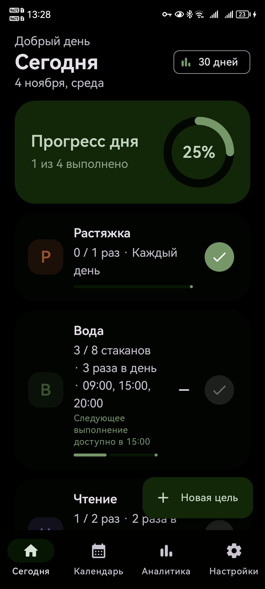
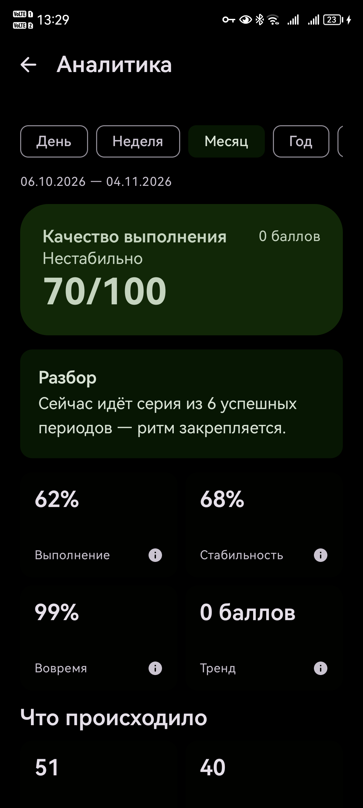
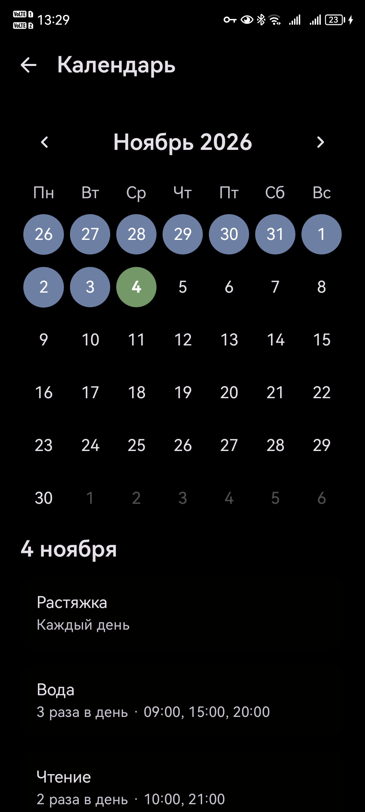
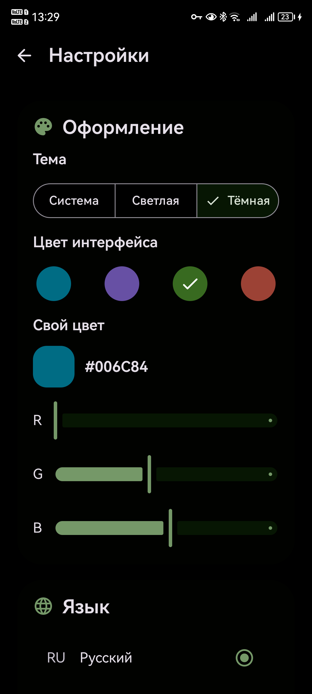

# Ritmo

Ritmo — local-first Android-приложение для целей и привычек. Оно поддерживает гибкие интервалы, несколько выполнений в день, точные напоминания, действия из уведомлений и часов, календарь, аналитику и домашний виджет.

Данные хранятся локально на устройстве. Аккаунт и сервер не нужны.

## Скриншоты

<p align="center">
  
  
  
  
</p>

## Возможности

- интервалы, дни недели и числа месяца;
- несколько выполнений в день с отдельными временными слотами;
- действия «Выполнено», «Отложить» и «Пропустить» в уведомлениях;
- действие «Выполнено» на совместимых часах Wear OS;
- календарь и подробная аналитика;
- светлая, тёмная и системная темы, акцентные цвета;
- русский и английский интерфейс;
- виджет целей на сегодня;
- полностью локальное хранение данных.

## Стек

Kotlin, Jetpack Compose, Material 3, MVVM, Coroutines/Flow, Room, Hilt и DataStore. minSdk 26, targetSdk 36.

## Сборка

Воспроизводимая сборка через Docker:

```bash
docker build --progress=plain --output type=local,dest=dist .
```

APK появится в `dist/ritmo-debug.apk`. Без приватного keystore Gradle использует стандартную debug-подпись. Также проект можно открыть и запустить в Android Studio.

### Собственная постоянная подпись

Создайте `keystore/ritmo.jks`, скопируйте `keystore.properties.example` в `keystore.properties` и заполните значения. Приватные файлы уже добавлены в `.gitignore` и не должны попадать в Git.

## Структура

```text
app/src/main/java/com/ritmo/app/
├── data/           # Room и реализация репозитория
├── di/             # Hilt-модули
├── domain/         # модели, расписание и аналитика
├── notifications/  # будильники и уведомления
├── settings/       # тема, язык и DataStore
├── ui/             # Compose-экраны и навигация
└── widget/         # домашний виджет
```

## Разрешения

- `POST_NOTIFICATIONS` — показ напоминаний;
- `SCHEDULE_EXACT_ALARM` — доставка напоминаний максимально близко к выбранному времени.

## Участие в разработке

Прочитайте [CONTRIBUTING.md](CONTRIBUTING.md). Уязвимости сообщайте по правилам из [SECURITY.md](SECURITY.md), а не публичным issue.

## Лицензия

Apache License 2.0. См. [LICENSE](LICENSE).

Политика обработки локальных данных описана в [PRIVACY.md](PRIVACY.md).
